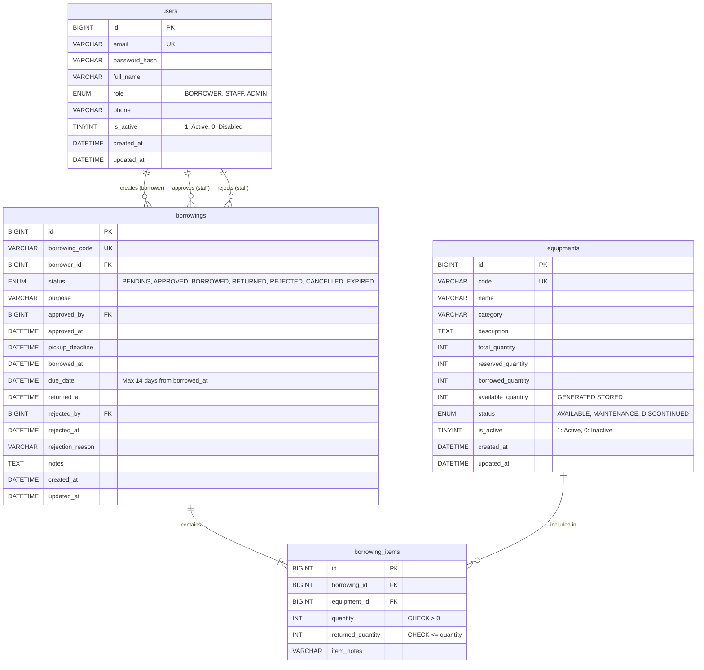

# Rikkei Lab - Equipment Borrowing Database Architecture & Deployment

Hệ thống Cơ sở dữ liệu Quản lý Mượn trả Thiết bị Rikkei Lab (Target DBMS: MySQL 8.4 InnoDB).

---

## 1. Kiến trúc & Quyết định Kỹ thuật

- **RDBMS Engine:** MySQL 8.4 LTS với storage engine InnoDB hỗ trợ chuẩn ACID toàn vẹn.
- **Bảng mã & Đối chiếu:** `utf8mb4` kết hợp collation `utf8mb4_0900_ai_ci` hỗ trợ đa ngôn ngữ và emoji đầy đủ.
- **Port:**
  - Container port: `3306`
  - Host port: `3307` (do cổng mặc định 3306 trên máy host đã bị chiếm bởi dịch vụ `mysqld` cục bộ; cấu hình linh hoạt qua biến môi trường `MYSQL_PORT`).
- **Chiến lược Quản lý Tồn kho & Đặt trước:**
  - `total_quantity`: Tổng số thiết bị thuộc quyền sở hữu của Lab.
  - `reserved_quantity`: Số lượng đang giữ chỗ cho các đơn có trạng thái `APPROVED` (chờ nhận).
  - `borrowed_quantity`: Số lượng thực tế đang mượn ngoài phòng Lab (`BORROWED`).
  - `available_quantity`: Số lượng sẵn sàng cho mượn, được tính toán tự động bằng Generated Column:
    `available_quantity = total_quantity - reserved_quantity - borrowed_quantity (STORED)`.
  - Toàn vẹn dữ liệu được đảm bảo thông qua CHECK constraints ngăn chặn tồn kho âm và mượn vượt số lượng khả dụng.

---

## 2. Cấu trúc Thư mục

```text
db/
├── docker-compose.yml   # File điều phối khởi chạy MySQL container
├── .env.example         # File biến môi trường mẫu
├── .env                 # File biến môi trường hoạt động (không commit lên git)
├── schema.sql           # Định nghĩa cấu trúc bảng, PK, FK, CHECK, Index
├── seed.sql             # Dữ liệu mẫu (Users, Equipments, Borrowings, Items)
└── README.md            # Tài liệu kiến trúc và hướng dẫn vận hành
```

---

## 3. Hướng dẫn Khởi chạy MySQL bằng Docker

### 3.1. Chuẩn bị biến môi trường
Nếu chưa có file `.env`, sao chép từ `.env.example`:
```bash
cp .env.example .env
```

Nội dung `.env`:
```env
MYSQL_PORT=3307
MYSQL_DATABASE=rikkei_lab
MYSQL_USER=rikkei_user
MYSQL_PASSWORD=RikkeiSecurePassword2026!
MYSQL_ROOT_PASSWORD=RikkeiRootPassword2026!
```

### 3.2. Khởi chạy Container
Di chuyển vào thư mục `db/` và chạy lệnh:
```bash
docker compose up -d
```

### 3.3. Kiểm tra trạng thái Container
```bash
docker ps --filter "name=rikkei-lab-mysql"
```
Kết quả hiển thị `(healthy)` cho biết MySQL đã sẵn sàng nhận kết nối và các file `schema.sql`, `seed.sql` đã được nạp tự động qua thư mục `/docker-entrypoint-initdb.d/`.

### 3.4. Kết nối kiểm tra bằng MySQL Client / CLI
```bash
# Kết nối qua container CLI bằng tài khoản ứng dụng
docker exec -it rikkei-lab-mysql mysql -u rikkei_user -pRikkeiSecurePassword2026! rikkei_lab

# Hoặc kết nối qua root
docker exec -it rikkei-lab-mysql mysql -u root -pRikkeiRootPassword2026! rikkei_lab
```

---

## 4. Thiết kế Thực thể & Quan hệ (ERD)



---

## 5. Danh mục Bảng & Ràng buộc Toàn vẹn

1. **`users`**:
   - `PK`: `id`
   - `UK`: `uk_users_email` (`email`)
   - `CHECK`: `chk_users_role` (`role IN ('BORROWER', 'STAFF', 'ADMIN')`), `chk_users_is_active` (`is_active IN (0, 1)`).
   - Bảo toàn lịch sử: Tài khoản không bị xóa cứng mà đánh dấu `is_active = 0`. Khóa ngoại ở bảng `borrowings` sử dụng `ON DELETE RESTRICT` ngăn ngừa xóa người dùng đã có giao dịch.

2. **`equipments`**:
   - `PK`: `id`
   - `UK`: `uk_equipments_code` (`code`)
   - `CHECK`:
     - `chk_equipments_quantities`: `total_quantity >= 0 AND reserved_quantity >= 0 AND borrowed_quantity >= 0 AND (reserved_quantity + borrowed_quantity) <= total_quantity`.
     - `chk_equipments_available`: `available_quantity >= 0`.
   - `Generated Column`: `available_quantity` lưu trữ sẵn giá trị tồn kho thực tế khả dụng.
   - Bảo toàn dữ liệu: Khóa ngoại từ `borrowing_items` trỏ về với `ON DELETE RESTRICT`, không cho phép xóa thiết bị đã từng phát sinh phiếu mượn.

3. **`borrowings`**:
   - `PK`: `id`
   - `UK`: `uk_borrowings_code` (`borrowing_code`)
   - `FK`:
     - `fk_borrowings_borrower` -> `users(id)` (`RESTRICT`)
     - `fk_borrowings_approved_by` -> `users(id)` (`RESTRICT`)
     - `fk_borrowings_rejected_by` -> `users(id)` (`RESTRICT`)
   - `CHECK`:
     - `chk_borrowings_dates`: Thời hạn mượn so sánh trực tiếp ngày: `due_date <= DATE_ADD(borrowed_at, INTERVAL 14 DAY)`.
     - `chk_borrowings_returned_date`: `returned_at >= borrowed_at`.

4. **`borrowing_items`**:
   - `PK`: `id`
   - `UK`: `uk_borrowing_items_pair` (`borrowing_id`, `equipment_id`) - mỗi loại thiết bị chỉ xuất hiện 1 dòng trong 1 phiếu.
   - `FK`:
     - `fk_borrowing_items_borrowing` -> `borrowings(id)` (`ON DELETE RESTRICT` - ngăn xóa cứng phiếu mượn để bảo toàn lịch sử giao dịch)
     - `fk_borrowing_items_equipment` -> `equipments(id)` (`ON DELETE RESTRICT`)
   - `CHECK`:
     - `chk_borrowing_items_qty`: `quantity > 0`
     - `chk_borrowing_items_returned_qty`: `returned_quantity >= 0 AND returned_quantity <= quantity`.

---

## 6. Chiến lược Transaction & Xử lý Đồng thời (Concurrency)

Mọi thao tác thay đổi trạng thái và cập nhật số lượng thiết bị phải được thực hiện trong **Transaction** (sử dụng `mysql2/promise` ở tầng Service Backend sau này). Chi tiết xem tại [transaction-guidelines.sql](file:///d:/Các%20hệ%20thống%20phân%20tán/RIKKEILAB/db/transaction-guidelines.sql).

### 6.1. Hướng dẫn kỹ thuật cho Backend (mysql2/promise):
1. **Dùng chung 1 Connection:** Luôn lấy một kết nối riêng từ pool (`const connection = await pool.getConnection();`) và thực thi toàn bộ các câu lệnh trong transaction trên connection đó (`connection.beginTransaction()`, `connection.execute()`, `connection.commit()`, `connection.rollback()`). Cuối cùng luôn giải phóng kết nối trong khối `finally` (`connection.release()`).
2. **Chống Deadlock:** Luôn sắp xếp các ID thiết bị theo thứ tự tăng dần (`ORDER BY id ASC`) khi khóa nhiều dòng bằng `SELECT ... FOR UPDATE`.
3. **Prepared Statements với `IN (?)`:** Tạo danh sách placeholder tương ứng với số phần tử (`ids.map(() => '?').join(', ')`), tránh mặc định một dấu `?` cho mảng ID.

### 6.2. Quy tắc nghiệp vụ chính:
- **Duyệt yêu cầu (Approve):** Bên cạnh kiểm tra `available_quantity >= requested_quantity`, bắt buộc kiểm tra `is_active = 1` và `status = 'AVAILABLE'` (thiết bị không bảo trì hoặc ngừng khai thác).
- **Hoàn trả (Return):** Hỗ trợ **hoàn trả từng phần (Partial Return)**. Tăng `returned_quantity` và giảm `borrowed_quantity` tương ứng. Chỉ chuyển phiếu sang `RETURNED` khi toàn bộ thiết bị trong phiếu đã trả đủ (`returned_quantity = quantity`).
- **Phân định rõ Từ chối (Reject) và Hủy (Cancel):**
  - **Staff Từ chối (`REJECTED`):** Ghi nhận `rejected_by`, `rejected_at`, `rejection_reason`. Nếu đơn từng `APPROVED`, giải phóng `reserved_quantity`.
  - **Borrower Hủy (`CANCELLED`):** Ghi nhận lý do vào `notes`, **không** ghi nhận vào các trường `rejected_*` của nhân viên. Nếu đơn từng `APPROVED`, giải phóng `reserved_quantity`.
5. Kết thúc: `COMMIT;` (Nếu có bất kỳ ngoại lệ nào xảy ra: `ROLLBACK;`).

---

## 7. Thiết kế Index & Tối ưu Truy vấn

1. `uk_users_email` (`users.email`):
   - Phục vụ đăng nhập qua email.
   - Độ phức tạp $O(1)$ / $O(\log N)$, loại trừ quét toàn bảng.
2. `uk_equipments_code` (`equipments.code`):
   - Tra cứu nhanh thông tin theo mã thiết bị.
3. `idx_equipments_category_status` (`equipments.category`, `status`, `is_active`):
   - Phục vụ bộ lọc danh mục và thiết bị sẵn sàng trong trang Catalog.
4. `idx_borrowings_borrower_created` (`borrowings.borrower_id`, `created_at DESC`):
   - Xem lịch sử đơn mượn của cá nhân sắp xếp theo thời gian mới nhất (tránh Filesort).
5. `idx_borrowings_status_created` (`borrowings.status`, `created_at DESC`):
   - Dashboard của Staff/Admin để lọc danh sách đơn theo trạng thái (PENDING, APPROVED, ...).
6. `idx_borrowings_status_deadlines` (`borrowings.status`, `pickup_deadline`, `due_date`):
   - Tối ưu truy vấn cronjob quét đơn quá hạn nhận (`status = 'APPROVED' AND pickup_deadline < NOW()`) và đơn quá hạn trả (`status = 'BORROWED' AND due_date < NOW()`).
7. `idx_borrowing_items_equipment` (`borrowing_items.equipment_id`):
   - Phục vụ truy vấn ngược tìm các phiếu mượn có chứa thiết bị này khi lập kế hoạch bảo trì.
